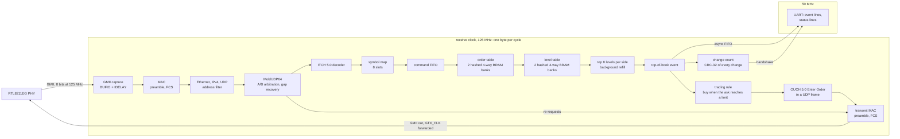

# FPGA ITCH feed handler

[](https://github.com/DuClare/fpga-itch-feed-handler/actions/workflows/test.yml)

A Nasdaq market-data feed handler in [Hardcaml](https://github.com/janestreet/hardcaml),
running on a QMTech Wukong board (Xilinx Artix-7 XC7A100T, RTL8211EG
gigabit PHY). It takes Ethernet frames straight from the PHY, parses
IPv4/UDP/MoldUDP64/ITCH 5.0 one byte per clock, maintains full-depth order
books for eight configurable symbols in block RAM, and emits a top-of-book
event after every book command. A deliberately simple trading rule reacts
to those events and sends OUCH 5.0 orders back out of the same PHY, and the
board measures its tick-to-trade latency. An OCaml reference book and a bit-accurate
model of the hardware's data structures check it at every level, from unit
tests to the board. [DESIGN.md](DESIGN.md) explains the data structures and
trade-offs.

## Results

- **On the board, over a 1 Gb/s Ethernet link, it reproduces the whole
  dataset.** 1,655,585 frames of real Nasdaq data (1.75 million messages)
  produce 1,043,727 top-of-book changes, whose on-chip count and CRC-32 are
  exactly the reference book's
  ([`results/board_gigabit.txt`](results/board_gigabit.txt)).
- **Tick-to-trade: 72 ns, measured on the board.** From the last byte of
  the market-data message that triggers an order, on the FPGA's GMII
  receive pins, to the order frame's first byte on its transmit pins: 9
  cycles at 125 MHz for every one of the 53 orders the board's rule sends
  on the dataset, each byte-identical to the model's order
  ([`results/board_recovery.txt`](results/board_recovery.txt)). It was
  112 ns before the receive MAC stopped holding bytes back for the FCS and
  orders stopped passing through a queue; waiting for the order book
  instead took 288 ns median, 384 ns worst
  ([`results/board_gigabit.txt`](results/board_gigabit.txt)).
- **Book latency: 160 ns median, 248 ns at p99** (20 and 31 cycles), from a
  message's last byte to its top-of-book event, measured on chip for each
  of the 1.74 million book commands, and equal to the cycle-exact
  simulation.
- **Timing closes at 125 MHz** in Vivado, for the core and for the gigabit
  board image, whose GMII inputs are constrained to the PHY datasheet's
  3 ns window.
- **No mismatches anywhere:** the RTL equals the reference book on all
  1,043,727 changes in simulation, and equals the architectural model event
  by event, including internal counters, on random sequences with tiny
  tables.

## Architecture



- **Parsing** is cut-through, one byte per clock with no backpressure, so a
  message is decoded as its last byte arrives.
- **Orders** (up to 32,768) live in two hashed four-way BRAM banks with
  bounded cuckoo displacement.
- **Price levels** (up to 16,384) live in two more hashed banks, keyed by
  symbol, side and price.
- **Top of book** comes from a small cache per book side: the best eight
  levels, kept sorted. When a cache runs low, a background scan of the level
  table refills it while the book keeps processing commands.
- **Order entry**: on the configured symbol, when the best offer falls to a
  limit (the board's: 100 SPY at $300.00), one immediate-or-cancel buy at
  the offer, once per crossing. A sell Add at or below the limit crosses by
  itself, so it is decided straight from the message bytes as its price
  arrives, without waiting for the book, and the order's preamble is
  already on the wire by then (pre-formed from the moment the message is
  known to be a candidate, dropped before any SFD if the price is too
  high). The Ethernet/IPv4/UDP header is a constant (zero UDP checksum), so
  the frame goes straight from registers into the transmit MAC, on the
  receive clock: no clock crossing on the way out.
- **Capacity failures** (a full table, an unsupported field value) are
  counted, never silent.

## Verification

Five layers, each checked against the one above
([DESIGN.md section 6](DESIGN.md#6-verification-strategy)):

1. **Reference book** (`src/model/book.ml`): a hash table and per-side price
   maps, property-tested against a naive model that rescans every order.
2. **Architectural model** (`src/model/hw_book.ml`): the hardware's hashes,
   capacities, collisions and cache rules, untimed. Equal to the reference
   on random sequences and on the full sample.
3. **RTL tests** (`tests/hw`): every stage against a reference, with
   waveform expect tests. The order book is compared with the architectural
   model on random sequences with tiny tables and several command spacings,
   including its internal counters. Real frames go through the GMII MAC at
   the minimum inter-frame gap. Gap recovery gets two lines that each lose
   10 to 20% of packets, reordered packets and a retransmission server that
   answers always, half the time or never, alone and through the whole
   board: the output is always in sequence, and with answers, complete.
4. **Full pipeline** (`bin/verify.ml`, Verilator): every frame of the
   tracked pcap at exact 1 Gb/s line rate. Every book event is compared with
   the reference by MoldUDP64 sequence number, and latency is measured per
   message.
5. **Board** (`scripts/board_recovery.sh`, `scripts/board_linerate.sh`):
   the pcap over a cable, compared through an on-chip count and CRC-32 of
   every change.

The data is a 32.6-million-message prefix of Nasdaq's public
[07302019 ITCH 5.0 sample](https://emi.nasdaq.com/ITCH/Nasdaq%20ITCH/),
filtered to the eight tracked symbols: 1,752,946 messages in 1,655,589
MoldUDP64 packets (`build/tracked.pcap`).

| Measured | Result |
| --- | --- |
| Full replay, simulation ([`verify_tracked.txt`](results/verify_tracked.txt)) | 1,740,696 book commands, 1,043,727 changes, 0 mismatches, 0 overflows |
| Event latency, 125 MHz cycles | p50 20, p99 31, p99.9 41, max 1,059 (2,761 before level windows and scan pre-emption); 72 commands (0.0041%) over 64 |
| Peak table occupancy | 27,573 / 32,768 orders; 7,633 / 16,384 levels |
| Book FIFO peak | 25 / 512 commands |
| Background cache refills | 5,322; commands waited 6,413 cycles in total |
| Core at 125 MHz, Vivado ([`timing.txt`](results/timing.txt)) | met, WNS +0.095 ns; 14,543 LUTs (23%), 8,983 FFs (7%), 98 BRAM tiles (73%) |
| 1 Gb/s board image (order entry, gap recovery), Vivado | met, WNS +0.044 ns, WHS +0.025 ns; 20,941 LUTs (33%), 117.5 BRAM tiles (87%); GMII inputs +0.44 / +0.45 ns, outputs +1.65 / +3.69 ns setup / hold |
| 1 Gb/s board, whole dataset over a cable | 1,043,727 changes, count and hash equal to the reference |
| Orders on the board, whole dataset | 53 of 53 equal to the model's; tick-to-trade 72 ns pin to pin for every order (112 ns before the cuts of DESIGN.md section 11) |
| Gap recovery on the board ([`board_recovery.txt`](results/board_recovery.txt)) | two lines each losing 2% of packets (643 lost on both), at 60,000 frames/s and at the host's top speed (138,000 frames/s, ~100,000 gaps, 80,000 re-requests): all 1,752,946 messages recovered in sequence, changes and hash equal to the reference, 53 of 53 orders |
| Book latency on the board (every command) | p50 20, p99 31, p99.9 40 cycles, as in simulation |
| 100 Mb/s board, cable and on-chip self-test | 39 changes, all equal to the model |
| Orders, whole board in simulation ([`test_board.ml`](tests/hw/test_board.ml)) | 27 of 27 frames at the transmit pins equal to the model's; tick-to-trade 7 or 8 cycles (21 orders decided from the message), up to 42 |

Latency runs from the cycle the last byte of a message leaves the MAC to
the cycle its event is valid. The tail comes from commands that find their
side's cache empty and wait for the refill scan; with a blocking refill,
p99 was 672 cycles and the maximum 6,016
([`verify_tracked_blocking.txt`](results/verify_tracked_blocking.txt)).

## On the board

The Wukong's RTL8211EG PHY delivers received bytes on an 8-bit GMII bus at
125 MHz (pinout from the QMTech
[schematic](https://github.com/ChinaQMTECH/QM_XC7A100T_WUKONG_BOARD/blob/master/V3/Hardware/QMTECH-XC7A100T_200T-Wukong-Board-V03-20240121.pdf)
and [example](https://github.com/ChinaQMTECH/QM_XC7A100T_WUKONG_BOARD/blob/master/V3/Software/XC7A100T/Test08_GMII_Ethernet.zip),
in [`fpga/wukong.xdc`](fpga/wukong.xdc)). The receive path runs on the PHY's
clock; a 50 MHz domain drives a UART that prints an `E` line per
top-of-book change and, once a second, an `S` line with every counter. At
full rate the UART drops `E` lines, so the receive domain also keeps a count
and a CRC-32 of every change; comparing those two numbers with the reference
book (`pcapgen expect`) checks every change.

**1 Gb/s, whole dataset.** Over a direct 1000 Mb/s cable at 60,000
frames/s, the board received 1,655,585 of the 1,655,589 frames (the PC
dropped the last four), 1,752,942 messages, with no duplicates, gaps, FCS
errors or overflows. Its count and hash, 1,043,727 changes and `186f6e17`,
equal the reference book's for the complete pcap.

**1 Gb/s, top speed.** At 132,000 frames/s (99.5 Mb/s on average, frames
reaching the NIC as little as 0.95 us apart) the PC itself drops and
reorders frames before they reach its NIC, and tcpreplay still reports them
as sent. The test therefore records the frames leaving the host with
tcpdump, rebuilds them in that order, and runs the reference book on them
with the hardware's MoldUDP64 rule (a late message is a duplicate). The
board matches it exactly: 1,655,466 frames, 729,207 duplicates, 45,278 gaps,
2,948 changes, hash `6e0f8b00`. The same comparison is what showed that the
sender, not the board, was reordering
([DESIGN.md section 10](DESIGN.md#10-the-1-gbs-test-when-the-counters-pointed-at-the-sender)).

**Latency on chip.** The board image timestamps every book command as it
enters the book and computes its latency when the command's event comes
out (commands and events are one to one and in order), adding the fixed
5-cycle pipeline in front of the book so a sample is exactly the
simulation's latency. Samples go into a histogram in block RAM, which a
scanner in hardware walks continuously to publish the count, p50, p99,
p99.9 and maximum in the UART status line (`lat`, `l50`, `l99`, `l999`,
`lmax`); `scripts/board_linerate.sh` prints them. Simulation checks every
sample and every percentile against the definition used by the Verilator
replay ([`tests/hw/test_latency.ml`](tests/hw/test_latency.ml)).

**Orders out.** The gigabit image also carries the order entry, with
its rule built in: buy 100 SPY when the offer comes down to $300.00, which
fires 53 times on the tracked pcap. `scripts/board_linerate.sh` captures
the frames the board sends and requires them, in order, to equal the
model's orders for the stream that was sent (`pcapgen orders`), and prints
the tick-to-trade the board measured between its GMII pins (`osent`,
`odrop`, `tt`, `t50`, `t99`, `tmax`). The transmit side runs on the receive
clock, with GTX_CLK forwarded inverted through an ODDR so the PHY samples
the IOB output registers mid-cycle, and Vivado checks it against the
datasheet's 2 ns setup and 0 ns hold. On the board all 53 orders arrived
at the PC equal to the model's, each 72 ns pin to pin.

**Receiving at 125 MHz.** The PHY guarantees each byte only from 2.5 ns
before to 0.5 ns after its clock edge. The board image captures it with
BUFIO-clocked input registers behind a 26-tap IDELAY on every data pin,
which Vivado times against that window with +0.44 ns setup and +0.45 ns hold
margin; a phase-shifted MMCM cannot meet both
([DESIGN.md section 8](DESIGN.md#8-clocking-and-reset-on-the-board)).

**Bring-up.** The first cable test decoded every frame but the book
processed nothing, while every simulation passed. An on-chip self-test
(frames played from a ROM, no PHY or network) and a BRAM probe found three
problems that only exist on silicon, all in the open-source toolchain
([DESIGN.md section 9](DESIGN.md#9-board-bring-up-what-simulation-did-not-catch)):
yosys's FSM re-encoding, a nextpnr bug that left one BRAM parity pin
unconnected (fixed in [openXC7/nextpnr#63](https://github.com/openXC7/nextpnr/pull/63)),
and bitstreams that failed at speed despite 2-4x reported margin. Board
images are therefore built with Vivado, and its builds of the same Verilog
are correct on the self-test at 50 MHz
([`board_toolchains.txt`](results/board_toolchains.txt)), over the cable at
100 Mb/s ([`board_cable_vivado.txt`](results/board_cable_vivado.txt)) and at
1 Gb/s.

## Reproduce

Developed with OCaml 5.2+Ox, dune 3.24, Hardcaml
`v0.18~preview.130.106+341`, Verilator 5.032, Vivado 2026.1, and openXC7
(Yosys 0.52 and nextpnr-xilinx; its scripts expect `/opt/openxc7` and a chip
database at `~/hardcaml-tutorial/fpga/build/xc7a100tfgg676.bin`).

```bash
eval "$(opam env --switch=oxcaml)"
make data          # fetch a prefix of the Nasdaq sample (scripts/fetch_itch.sh)
make test          # model and hardware tests
make pcaps         # build/tracked.pcap and friends
dune exec bin/verify.exe -- build/tracked.pcap -verilator -report results/verify_tracked.txt
TOP=timing_top XDC=fpga/timing_top.xdc SYNTH_OPTS=-retiming PLACE_DIRECTIVE=ExtraTimingOpt \
  PHYS_DIRECTIVE=AggressiveExplore ROUTE_DIRECTIVE=AggressiveExplore \
  ./fpga/vivado_build.sh fpga/build/timing_top.v fpga/build/vivado_timing   # core timing
```

The sample prefix used has SHA-256
`546e9e4b522556533387e574ce1ba632beebe83701b72251a6600893f46a1ec6`. Each
test directory is its own dune root (`ppx_expect` needs that); tests that
need the sample or the pcaps skip without them. `fpga/build/timing_top.v`
comes from `dune exec bin/gen_verilog.exe -- timing_top fpga/build/timing_top.v`.

**1 Gb/s board test**, with the Wukong on a direct cable to `eno1` and
`tcpreplay` installed (the scripts make the `sudo` network changes and undo
them):

```bash
dune exec bin/gen_verilog.exe -- board_top_gmii 26 fpga/build/board_top_gmii.v
SYNTH_OPTS=-retiming OPT_OPTS="-retarget -propconst -sweep" PLACE_DIRECTIVE=ExtraTimingOpt \
  PHYS_DIRECTIVE=AggressiveExplore ROUTE_DIRECTIVE=AggressiveExplore \
  ./fpga/vivado_build.sh fpga/build/board_top_gmii.v fpga/build/vivado_gmii 8   # 8: the receive clock period, ns
cp fpga/build/vivado_gmii/board_top.bit fpga/build/board_top_gmii.bit
./scripts/fpga_connect.sh      # program; send lines A and B with losses; answer re-requests; compare
./scripts/fpga_disconnect.sh   # after unplugging: eno1 back to NetworkManager
```

`fpga_connect.sh` runs `scripts/board_recovery.sh`: `pcapgen ab` builds the
two lines (2% of packets lost on each, `DROP_A`/`DROP_B`), and
`scripts/mold_server.py` (root, raw sockets) answers the board's
re-requests with the recorded session. Whatever the lines, the host's
sender and the retransmissions do, the board must end with the reference
book's changes and orders over the whole session. `AB=0` sends the
recorded feed on one line, `PPS=R` paces it, `LIMIT=N` replays a prefix.
For an image without recovery, `TEST=linerate` runs
`scripts/board_linerate.sh` (the model on what the host really sent;
`scripts/board_sweep.sh` runs several rates).

**100 Mb/s board test** (MII image, 400 packets through the host's UDP
stack, every `E` line compared):

```bash
make board-pcap                        # build/board_slow.pcap
TARGET_MHZ=50 ./fpga/build_board.sh    # writes fpga/build/board_top_50.v (and an openXC7 image)
./fpga/vivado_build.sh fpga/build/board_top_50.v fpga/build/vivado_board50 40
sudo nmcli device set eno1 managed no && sudo ip link set eno1 up
sudo ethtool -s eno1 advertise 0x008 autoneg on        # 100 Mb/s only
sudo ip address add 192.168.10.1/24 dev eno1
BITSTREAM=fpga/build/vivado_board50/board_top.bit make replay
sudo ip address del 192.168.10.1/24 dev eno1
sudo ethtool -s eno1 advertise 0x02f autoneg on && sudo nmcli device set eno1 managed yes
```

**On-chip self-test** (no PHY or network):

```bash
SELFTEST_PCAP=build/board_subset.pcap TARGET_MHZ=50 ./fpga/build_board.sh
openFPGALoader-xpcu -c xilinxPlatformCableUsb fpga/build/board_top_50_selftest.bit
./fpga/netlist_sim/run.sh selftest     # the same netlist in gate-level simulation
```

## Repository

| Path | Contents |
| --- | --- |
| `src/model` | ITCH 5.0 codec, reference book, architectural model of the hardware book, CRC-32 |
| `src/net` | Ethernet/IPv4/UDP/MoldUDP64 frames and pcap files |
| `src/hw` | the RTL: GMII/MII MAC, frame and MoldUDP64 parsers, ITCH decoder, symbol filter, order book, board top with UART and GMII capture |
| `bin` | `verify` (full-pipeline replay), `pcapgen` (pcaps, expected board output), `itch_tool` (data profiling), `gen_verilog` |
| `tests` | model, network and hardware test suites (separate dune roots) |
| `fpga` | constraints, Vivado and openXC7 builds, gate-level simulation |
| `scripts` | data download, board replay and line-rate tests |
| `results` | every measurement quoted here |

## Limits

- **Sender:** the 1 Gb/s board test is limited by the PC, which averages
  about 100 Mb/s with tcpreplay and drops and reorders frames above about
  60,000 frames/s. Sustained 1 Gb/s traffic has only been simulated.
- **Feed recovery:** the board takes lines A and B and asks for what both
  miss, but its buffer holds 2,048 messages (32 KB): a retransmission that
  takes longer than the buffer lasts at the feed's rate costs more
  requests, or messages given up (counted, and flagged as stale).
- **Orders:** the rule is a demonstration, not a strategy: one symbol, one
  limit, no position or risk limits. OUCH 5.0 messages go out in UDP
  datagrams, while a real venue takes them over SoupBinTCP. Tick-to-trade
  is measured between the FPGA's GMII pins and excludes the PHY's own
  receive and transmit latency.
- **Checksums:** FCS, IP and UDP checksums do not gate cut-through book
  writes; the MAC counts bad FCS for diagnostics.
- **Field widths and capacity:** order references up to 32 bits, shares up
  to 24 bits per order, eight symbols. Unsupported values are counted.
- **Latency tail:** a command whose side's cache empties before the
  background refill finishes waits for the 2,048-row level scan; 63 of the
  1.74 million commands waited over 1,000 cycles.
- **Toolchain:** board images need Vivado. openXC7 builds carry two
  workarounds (no yosys FSM re-encoding; no BRAM table deeper than 2,048
  rows) and still failed at speed on the board
  ([`board_toolchains.txt`](results/board_toolchains.txt)).
- **Data:** the sample prefix is not a complete trading day.
